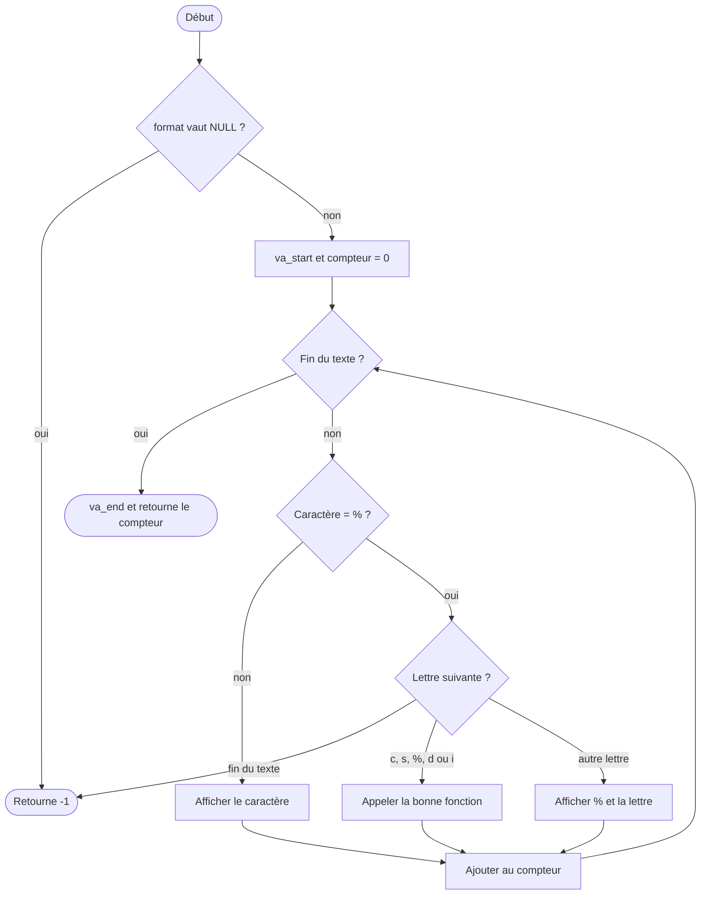

# _printf

Projet de groupe Holberton School réalisé par Zakir et Hugo.
Le but est de recoder une partie de la fonction `printf` du langage C, pour
comprendre comment elle fonctionne.

## Description

`_printf` affiche du texte à l'écran (la sortie standard). Quand elle trouve
un `%` suivi d'une lettre, appelé **spécificateur**, elle le remplace par
l'argument suivant.

```c
int _printf(const char *format, ...);
```

- `format` : le texte à afficher, avec des spécificateurs
- `...` : les arguments, en nombre variable (fonction **variadique**)
- **Retour** : le nombre de caractères affichés, ou `-1` si `format` vaut
  `NULL` ou se termine par un `%` seul

## Spécificateurs gérés

- `%c` : affiche un caractère
- `%s` : affiche une chaîne de caractères (`(null)` si elle vaut `NULL`)
- `%%` : affiche le signe `%`
- `%d` et `%i` : affichent un nombre entier, positif ou négatif

Une lettre inconnue (par exemple `%r`) est affichée telle quelle, comme avec
le vrai `printf`. Les flags, la largeur, la précision et les modificateurs
de longueur ne sont pas gérés.

## Prérequis

- Ubuntu 20.04 LTS et `gcc`
- Style Betty
- Fonctions autorisées : `write`, `malloc`, `free`, `va_start`, `va_end`,
  `va_copy`, `va_arg`

## Compilation

```bash
gcc -Wall -Werror -Wextra -pedantic -std=gnu89 -Wno-format *.c
```

Il n'y a pas de fonction `main` dans le projet : il faut en écrire une pour
utiliser `_printf`.

## Exemple

```c
#include "main.h"

int main(void)
{
	int length;

	length = _printf("Character:[%c]\n", 'H');
	_printf("String:[%s]\n", "I am a string !");
	_printf("Negative:[%d]\n", -762534);
	_printf("Percent:[%%]\n");
	_printf("Length:[%i]\n", length);
	return (0);
}
```

Sortie :

```
Character:[H]
String:[I am a string !]
Negative:[-762534]
Percent:[%]
Length:[14]
```

## Fichiers

- `main.h` : les includes, la structure et les prototypes
- `_printf.c` : `_printf` et `call_print_func`
- `_putchar.c` : `_putchar`, qui écrit un caractère avec `write`
- `handlers.c` : `print_char`, `print_string` et `print_percent`
- `print_numbers.c` : `print_int`
- `man_3_printf` : la page de manuel

## Fonctionnement

1. `_printf` lit le texte caractère par caractère.
2. Un caractère normal est affiché avec `_putchar`.
3. Quand elle trouve un `%`, elle donne la lettre suivante à
   `call_print_func`.
4. `call_print_func` cherche cette lettre dans un tableau. Chaque case du
   tableau associe une lettre à sa fonction grâce à un **pointeur de
   fonction**, par exemple `'c'` avec `print_char`.
5. La fonction trouvée lit l'argument avec `va_arg` et l'affiche.
6. Chaque fonction retourne le nombre de caractères affichés, et `_printf`
   fait le total.

## Flowchart



## Page de manuel

```bash
man ./man_3_printf
```

## Tests

On compare `_printf` avec le vrai `printf` : même affichage et même valeur
de retour. Le fichier de test est dans le dossier `tests`, pas à la racine.

```bash
gcc -Wall -Werror -Wextra -pedantic -std=gnu89 -Wno-format *.c tests/main.c -o test
./test
```

Cas testés : chaîne `NULL`, `0`, nombres négatifs, `INT_MAX`, `INT_MIN`,
`%%` et lettre inconnue.

On vérifie aussi la mémoire avec Valgrind :

```bash
valgrind --leak-check=full ./test
```

## Auteurs

- Zakir Asadov
- Hugo
